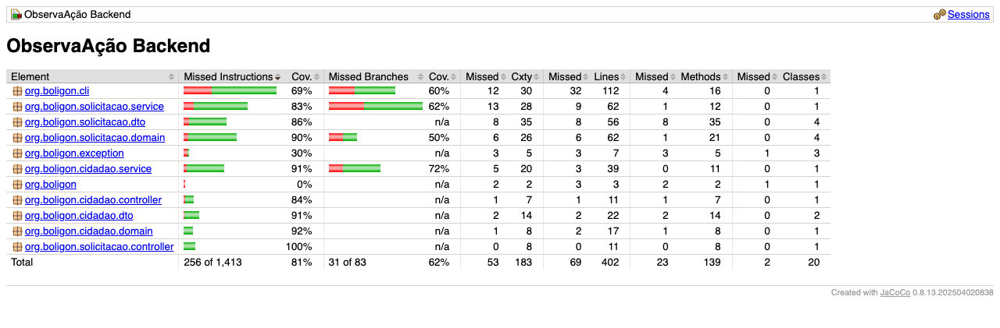

# Evidência de cobertura JaCoCo

Gerado após `mvn verify` no módulo `backend` (gate no `pom.xml`: **70%** de instruções no **total do projeto**, não por pacote).

## Total (o que o gate valida)

| Métrica | Valor |
|---------|------:|
| Instruções cobertas | 1.157 |
| Instruções não cobertas | 256 |
| **Cobertura (instruções)** | **81,9%** |
| Mínimo exigido (AEP) | 70% |

Na linha **Total** do relatório HTML aparece **81%** (mesmo valor, arredondado).

Pacotes podem ficar **abaixo de 70%** (ex.: `cli` ~69%, `exception` ~30%, classe `Application` 0%) e o `mvn verify` **ainda passa**, porque a regra JaCoCo é `element=BUNDLE` (soma de todo o `backend`).

## Pacotes (instruções) — última medição

| Pacote | Cobertura |
|--------|----------:|
| `org.boligon.solicitacao.controller` | 100% |
| `org.boligon.cidadao.service` | 91% |
| `org.boligon.cidadao.dto` | 91% |
| `org.boligon.solicitacao.domain` | 90% |
| `org.boligon.solicitacao.dto` | 86% |
| `org.boligon.cidadao.controller` | 84% |
| `org.boligon.solicitacao.service` | 83% |
| `org.boligon.cli` | 69% |
| `org.boligon.exception` | 30% |
| `org.boligon` (bootstrap) | 0% |

## Como reproduzir

```bash
cd backend
mvn verify
```

Relatório HTML: `backend/target/site/jacoco/index.html` — use a linha **Total** para comparar com o mínimo de 70%.

## Captura de tela

Gerada a partir de `backend/target/site/jacoco/index.html` após o mesmo `mvn verify` desta medição.


